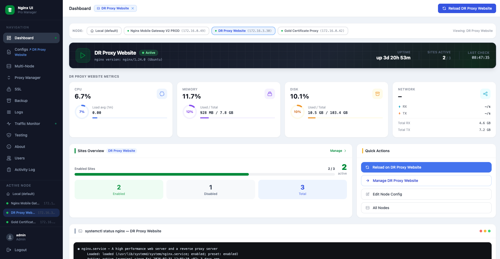
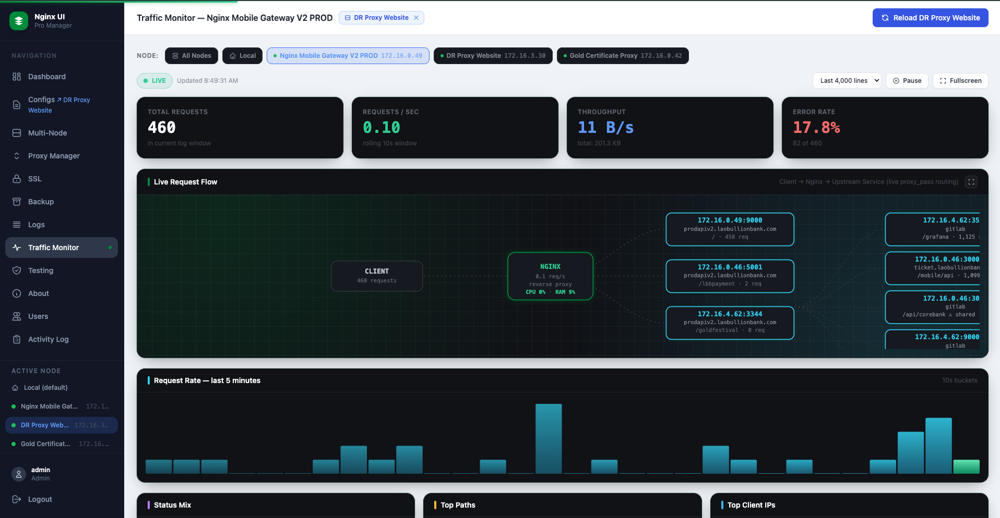

# Nginx UI Pro Manager

A modern web-based GUI for managing Nginx across one or many Ubuntu/Linux servers — built with FastAPI, Jinja2, and Tailwind CSS. No heavy frontend framework, no build step.

**GitHub:** https://github.com/PitiDev/nginx-ui-manager

---

## Overview


*Dashboard — live Nginx status, CPU / RAM / Disk / Network metrics*


*Traffic Monitor — real-time request activity*

---

## Features

| Feature | Description |
|---|---|
| **Dashboard** | Live Nginx status, CPU / RAM / Disk / Network metrics, auto-refresh every 5s |
| **Config Manager** | Create, edit, delete server block files in `/etc/nginx/sites-available` |
| **Site Toggle** | Enable / disable sites via symlinks in `/etc/nginx/sites-enabled` |
| **Validation & Reload** | Runs `nginx -t` before saving; reloads Nginx on demand |
| **Traffic Monitor** | Real-time request activity and stats |
| **Log Viewer** | Structured access + error log viewer with search, filters, color coding, and UA parsing |
| **SSL Manager** | Upload, view, and edit SSL certificate / key files |
| **Multi-Node** | Manage multiple remote Nginx servers from one UI |
| **User Management** | Admin and Viewer roles; JWT auth stored in `httpOnly` cookies |

---

## Quick Start

### 1. Prerequisites

- Docker and Docker Compose installed on your Ubuntu server
- Nginx already installed on the **host** (`apt install nginx`)
- The host user must be in the `sudo` group

### 2. Create working directory

```bash
mkdir -p ~/nginx_ui/data
cd ~/nginx_ui
```

### 3. Create `.env` file

```bash
cat > .env << 'EOF'
SECRET_KEY=replace-with-a-long-random-string
ADMIN_USERNAME=admin
ADMIN_PASSWORD=yourStrongPassword
TOKEN_EXPIRE_HOURS=8
USE_SUDO=true
SUDO_PASSWORD=your_sudo_password
SSL_DIR=/home/YOUR_USER/ssl
DATA_DIR=/data
EOF
```

> **Security:** Generate `SECRET_KEY` with `openssl rand -hex 32`. Never commit `.env` to git.

### 4. Create `docker-compose.yml`

```yaml
services:
  nginx_ui:
    image: pitidev/nginx-ui-manager:latest
    restart: unless-stopped
    ports:
      - "8080:8080"
    pid: host
    privileged: true
    volumes:
      - /etc/nginx:/etc/nginx
      - /var/log/nginx:/var/log/nginx
      - /run/systemd:/run/systemd
      - /var/run/dbus/system_bus_socket:/var/run/dbus/system_bus_socket
      - /home/YOUR_USER/ssl:/home/YOUR_USER/ssl
      - ~/nginx_ui/data:/data
    environment:
      USE_SUDO: ${USE_SUDO:-true}
      SUDO_PASSWORD: ${SUDO_PASSWORD:-}
      SECRET_KEY: ${SECRET_KEY:-change-this}
      ADMIN_USERNAME: ${ADMIN_USERNAME:-admin}
      ADMIN_PASSWORD: ${ADMIN_PASSWORD:-admin123}
      TOKEN_EXPIRE_HOURS: ${TOKEN_EXPIRE_HOURS:-8}
      SSL_DIR: ${SSL_DIR:-/home/YOUR_USER/ssl}
      DATA_DIR: ${DATA_DIR:-/data}
```

> Replace `YOUR_USER` with your actual Linux username (e.g. `ubuntu`, `user_admin`).

### 5. Pull and start

```bash
docker compose pull
docker compose up -d
```

### 6. Open the UI

```
http://YOUR_SERVER_IP:8080
```

Log in with the `ADMIN_USERNAME` / `ADMIN_PASSWORD` you set in `.env`.

---

## Environment Variables

| Variable | Default | Description |
|---|---|---|
| `SECRET_KEY` | *(required)* | JWT signing secret — use a random 32+ char string |
| `ADMIN_USERNAME` | `admin` | Initial admin username (bootstrapped on first start) |
| `ADMIN_PASSWORD` | `admin123` | Initial admin password |
| `TOKEN_EXPIRE_HOURS` | `8` | JWT token lifetime in hours |
| `USE_SUDO` | `true` | Set `true` to use `sudo` for nginx / systemctl commands |
| `SUDO_PASSWORD` | *(empty)* | Sudo password for the container's OS user |
| `SSL_DIR` | `/home/user_admin/ssl` | Host path where SSL files are stored |
| `DATA_DIR` | `/data` | Container path for persistent data (`users.json`) |
| `NGINX_ACCESS_LOG` | `/var/log/nginx/access.log` | Path to Nginx access log |
| `NGINX_ERROR_LOG` | `/var/log/nginx/error.log` | Path to Nginx error log |

---

## Roles

| Role | Permissions |
|---|---|
| **Admin** | Full access — create, edit, delete configs, SSL files, users; reload Nginx |
| **Viewer** | Read-only — view configs, SSL files, logs, dashboard; cannot make any changes |

---

## Tags

| Tag | Description |
|---|---|
| `latest` | Most recent stable build |

---

## Source

Full source, issue tracker, and documentation: https://github.com/PitiDev/nginx-ui-manager
