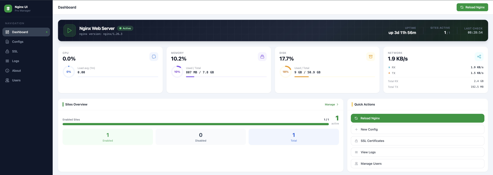

# Nginx UI Pro Manager

A modern web-based GUI for managing Nginx on Ubuntu/Linux servers — built with FastAPI, Jinja2, and Tailwind CSS. No heavy frontend framework, no build step. Just run and go.

**Docker Hub:** `pitidev/nginx-ui-manager:latest`

---

## Overview



---

## Features

| Feature | Description |
|---|---|
| **Dashboard** | Live Nginx status, CPU / RAM / Disk / Network metrics, auto-refresh every 5 s |
| **Config Manager** | Create, edit, delete server block files in `/etc/nginx/sites-available` |
| **Site Toggle** | Enable / disable sites via symlinks in `/etc/nginx/sites-enabled` |
| **Validation & Reload** | Runs `nginx -t` before saving; reloads Nginx on demand |
| **Log Viewer** | Structured access + error log viewer with search, filters, color coding, and UA parsing |
| **SSL Manager** | Upload, view, and edit SSL certificate / key files |
| **User Management** | Admin and Viewer roles; JWT auth stored in `httpOnly` cookies |
| **About Page** | System info and feature overview |

---

## Quick Start with Docker Hub

### 1. Prerequisites

- Docker and Docker Compose installed on your Ubuntu server
- Nginx already installed on the **host** (`apt install nginx`)
- The host user must be in the `sudo` group

### 2. Create working directory

```bash
mkdir -p ~/nginx_ui/data
cd ~/nginx_ui
```

### 3. Create `.env` file

```bash
cat > .env << 'EOF'
SECRET_KEY=replace-with-a-long-random-string
ADMIN_USERNAME=admin
ADMIN_PASSWORD=yourStrongPassword
TOKEN_EXPIRE_HOURS=8
USE_SUDO=true
SUDO_PASSWORD=your_sudo_password
SSL_DIR=/home/YOUR_USER/ssl
DATA_DIR=/data
EOF
```

> **Security:** Generate `SECRET_KEY` with `openssl rand -hex 32`. Never commit `.env` to git.

### 4. Create `docker-compose.yml`

```yaml
services:
  nginx_ui:
    image: pitidev/nginx-ui-manager:latest
    restart: unless-stopped
    ports:
      - "8080:8080"
    pid: host
    privileged: true
    volumes:
      - /etc/nginx:/etc/nginx
      - /var/log/nginx:/var/log/nginx
      - /run/systemd:/run/systemd
      - /var/run/dbus/system_bus_socket:/var/run/dbus/system_bus_socket
      - /home/YOUR_USER/ssl:/home/YOUR_USER/ssl
      - ~/nginx_ui/data:/data
    environment:
      USE_SUDO: ${USE_SUDO:-true}
      SUDO_PASSWORD: ${SUDO_PASSWORD:-}
      SECRET_KEY: ${SECRET_KEY:-change-this}
      ADMIN_USERNAME: ${ADMIN_USERNAME:-admin}
      ADMIN_PASSWORD: ${ADMIN_PASSWORD:-admin123}
      TOKEN_EXPIRE_HOURS: ${TOKEN_EXPIRE_HOURS:-8}
      SSL_DIR: ${SSL_DIR:-/home/YOUR_USER/ssl}
      DATA_DIR: ${DATA_DIR:-/data}
```

> Replace `YOUR_USER` with your actual Linux username (e.g. `ubuntu`, `user_admin`).

### 5. Pull and start

```bash
docker compose pull
docker compose up -d
```

### 6. Open the UI

```
http://YOUR_SERVER_IP:8080
```

Log in with the `ADMIN_USERNAME` / `ADMIN_PASSWORD` you set in `.env`.

---

## Update to Latest Version

```bash
docker compose pull
docker compose up -d
```

---

## Environment Variables

| Variable | Default | Description |
|---|---|---|
| `SECRET_KEY` | *(required)* | JWT signing secret — use a random 32+ char string |
| `ADMIN_USERNAME` | `admin` | Initial admin username (bootstrapped on first start) |
| `ADMIN_PASSWORD` | `admin123` | Initial admin password |
| `TOKEN_EXPIRE_HOURS` | `8` | JWT token lifetime in hours |
| `USE_SUDO` | `true` | Set `true` to use `sudo` for nginx / systemctl commands |
| `SUDO_PASSWORD` | *(empty)* | Sudo password for the container's OS user |
| `SSL_DIR` | `/home/user_admin/ssl` | Host path where SSL files are stored |
| `DATA_DIR` | `/data` | Container path for persistent data (`users.json`) |
| `NGINX_ACCESS_LOG` | `/var/log/nginx/access.log` | Path to Nginx access log |
| `NGINX_ERROR_LOG` | `/var/log/nginx/error.log` | Path to Nginx error log |

---

## Roles

| Role | Permissions |
|---|---|
| **Admin** | Full access — create, edit, delete configs, SSL files, users; reload Nginx |
| **Viewer** | Read-only — view configs, SSL files, logs, dashboard; cannot make any changes |

---

## Development Setup

```bash
# Clone
git clone https://github.com/pitiphanthasombath/nginx-ui.git
cd nginx-ui

# Install Python deps
pip install -r requirements.txt

# Run dev server (hot-reload)
uvicorn backend.main:app --reload --port 8080
```

Open `http://localhost:8080`. The app will bootstrap a default admin user from env vars (or `admin` / `admin123` if not set).

---

## Project Structure

```
nginx_ui/
├── backend/
│   ├── main.py        # FastAPI app, all routes
│   ├── auth.py        # JWT auth — create_token, verify_token
│   ├── nginx.py       # Nginx file I/O, symlinks, shell commands
│   ├── logs.py        # Log file parsing (access + error)
│   ├── ssl_mgr.py     # SSL file management
│   ├── system.py      # CPU, RAM, Disk, Network metrics
│   └── users.py       # JSON-file user store
├── frontend/
│   ├── templates/     # Jinja2 HTML templates
│   └── static/        # Static assets
├── Dockerfile
├── docker-compose.yml
├── deploy.sh          # Deploy to private registry + server
├── push_dockerhub.sh  # Build & push to Docker Hub
└── requirements.txt
```

---

## Push to Docker Hub (for maintainers)

```bash
# First time — log in to Docker Hub
docker login

# Build and push latest
sh push_dockerhub.sh

# Build and push a specific version tag
sh push_dockerhub.sh 1.0.0
```

The script builds a `linux/amd64` image, tags it, and pushes both the version tag and `latest`.

---

## Security Notes

- JWT tokens are stored in `httpOnly` cookies — not accessible by JavaScript
- All shell commands run by the backend are hardcoded (no user-controlled input reaches the shell)
- Viewer role blocks all write operations at the middleware level (not just the UI)
- Change `SUDO_PASSWORD` after initial setup and rotate `SECRET_KEY` before going to production

---

## Tech Stack

| Layer | Technology |
|---|---|
| Backend | Python 3.12, FastAPI, Uvicorn |
| Templates | Jinja2 |
| Styling | Tailwind CSS (CDN) |
| Editor | CodeMirror 5 |
| Auth | python-jose (JWT), bcrypt |
| Container | Docker, Docker Compose |
| Target OS | Ubuntu 20.04 / 22.04 / 24.04 |

---

## Developer

**Piti Phanthasombath** — Full-stack Developer & DevOps Engineer  
piti.phanthasombath@gmail.com

---

*Nginx UI Pro Manager · v1.0 · 2025*
